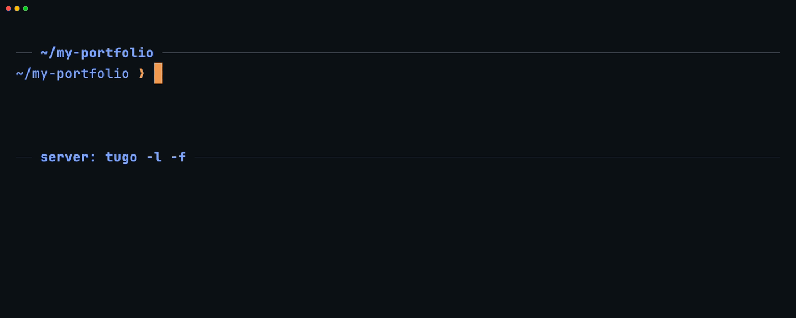
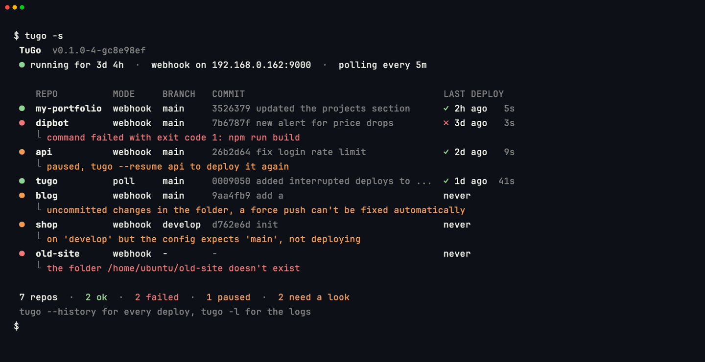

<p align="center">
  
</p>

<h1 align="center">TuGo</h1>

<p align="center">Push to GitHub. Your server updates itself.</p>

<p align="center">
  <a href="https://github.com/hope61/TuGo/actions/workflows/test.yml"></a>
  <a href="https://github.com/hope61/TuGo/releases/latest"></a>
</p>



Tugo keeps the apps on your server up to date. You push to GitHub. Tugo pulls the new code and runs your build and restart commands. You don't need to log in to the server for every change.

- **Small.** One Go binary and one config file.
- **Two modes.** Check every few minutes (poll), or get the change right when you push (webhook).
- **Safe.** It only runs your commands when there is new code. A stuck command gets killed after a time limit.
- **Hands-off.** It runs as a systemd service and starts again if it crashes.

> [!NOTE]
> Tugo needs Linux with systemd, `git` and Go 1.26 or newer to build. Webhook setup also uses the [`gh`](https://cli.github.com) CLI.

## Contents

- [Install](#install)
- [Config](#config)
- [Webhook mode](#webhook-mode)
- [Cloudflare Tunnel](#cloudflare-tunnel)
- [Status](#status)
- [Logs](#logs)
- [History](#history)
- [Pause a repo](#pause-a-repo)
- [Commands](#commands)
- [Project layout](#project-layout)

## Install

```
git clone https://github.com/hope61/tugo.git
cd tugo
sudo make service
```

This does four things:

1. It builds the `tugo` binary.
2. It copies it to `/opt/tugo`, along with the example config if there's no config there yet.
3. It links it to `/usr/local/bin/tugo`, so you can run `tugo` from anywhere.
4. It starts a `tugo` service. The service runs as your user, so it uses your git keys.

Next, [write your config](#config).

### Prebuilt binary

Every [release](https://github.com/hope61/TuGo/releases/latest) has ready binaries for Linux (amd64 and arm64), so you don't need Go. This installs only the binary, without the service:

```
curl -L https://github.com/hope61/TuGo/releases/latest/download/tugo_linux_amd64.tar.gz | tar xz
sudo mkdir -p /opt/tugo
sudo mv tugo /opt/tugo/ && sudo ln -sf /opt/tugo/tugo /usr/local/bin/tugo
sudo cp -n example-config.yaml /opt/tugo/config.yaml
```

On an ARM server, use `tugo_linux_arm64.tar.gz`. Run `tugo -v` to see which version you have.

## Config

Tugo reads `config.yaml` from the same folder as the binary. So the live config is `/opt/tugo/config.yaml`. The first install puts the example config there, so you only have to change it:

```
tugo -e
sudo systemctl restart tugo
```

> [!IMPORTANT]
> Always edit the config in `/opt/tugo`. A `config.yaml` in the repo folder only gets copied on the first install, instead of the example. After that, changes to it do nothing.

### A simple config

```yaml
mode: poll
interval: 5m
repos:
  - dir: /home/user/project-a
  - dir: /home/user/project-b
    remote: upstream
    branch: develop
    commands:
      - docker compose up -d --build
```

### All options

| Option | Default | What it does |
|---|---|---|
| `mode` | `poll` | `poll` or `webhook` |
| `interval` | `5m` | Time between checks in poll mode, like `30s`, `5m` or `1h` |
| `timeout` | `30m` | Kill a command that runs longer than this |
| `listen` | `:9000` | Address for webhooks |
| `url` | | Public webhook URL, used by `--add-hook` |

Each repo can have:

| Option | Default | What it does |
|---|---|---|
| `dir` | | Full path to the repo. You need this one |
| `remote` | `origin` | Git remote to pull from |
| `branch` | current branch | If the repo is on another branch, Tugo skips it and logs a warning |
| `mode` | top-level `mode` | Use a different mode for just this repo |
| `commands` | | Commands to run after new code is pulled |

### Commands

Tugo runs the commands only when it pulls new code. They run in order. If one fails, the rest don't run. You can join commands with `&&`:

```yaml
commands:
  - npm install && npm run build
  - systemctl restart myapp
```

If a command runs longer than `timeout`, Tugo kills it and everything it started. Because of this, one stuck build can't block your other repos.

### Force pushes

Tugo never merges. If you rewrite history on GitHub (for example `git commit --amend` and `git push --force`), the server's copy can't fast-forward anymore. Tugo then resets it to the remote branch and runs your commands, but only when nothing can be lost: the copy has no uncommitted changes, and its current commit is one the remote had before. If you made commits or changes on the server itself, Tugo leaves the copy alone and logs how to fix it.

### Edit with `tugo -e`

`tugo -e` works like `crontab -e`. It opens the config in your `$EDITOR`. If you don't have one, it lets you pick nvim, vim or nano. Then it saves your pick in `~/.bashrc` or `~/.zshrc`.

When you close the editor, Tugo checks the config. It only saves the config if it has no errors. If it has errors, Tugo shows them and lets you fix them.

## Webhook mode

In poll mode, Tugo checks every `interval`. In webhook mode, GitHub tells Tugo about a push, so Tugo pulls right away.

**1. Turn it on in the config.**

```yaml
mode: webhook
listen: :9000
url: https://your-host:9000/
```

`url` is the public address that GitHub calls.

**2. Restart Tugo.** It makes a secret in `/opt/tugo/webhook.secret` by itself. Only the service user can read it, so the secret stays safe even if someone sees `config.yaml`. Use the same secret for every repo. To see it, run `sudo cat /opt/tugo/webhook.secret`.

> [!NOTE]
> Do you still have `secret:` in `config.yaml` from an older version? Tugo moves it to `webhook.secret` and keeps your hooks working. Then delete the line from the config.

**3. Add the webhook to your repos.** First, log in with `gh auth login`. Then run:

```
tugo --add-hook hope61/project-a hope61/project-b
tugo --remove-hook hope61/project-a
```

Tugo skips repos that already have the webhook.

> [!TIP]
> Do you use a GitHub organization? Then you can add one webhook for all its repos. Go to the org's **Settings → Webhooks**. Use the same url and secret, content type `application/json`, and only the push event.

Tugo checks all webhook repos on each push. It also checks every repo when it starts, and once every 24 hours. Because of this, a lost webhook (for example, the tunnel was down) still gets pulled within a day.

### Mix poll and webhook

Each repo can set its own `mode`. This helps with repos that you can't add a webhook to. For example, Tugo can update itself by polling its own repo:

```yaml
mode: webhook
interval: 5m
repos:
  - dir: /home/user/my-app
  - dir: /home/user/tugo
    mode: poll
    commands:
      - sudo make service
```

Each mode only checks its own repos. However, checks still run one at a time. So a slow build in one repo can delay the next check of another repo.

> [!NOTE]
> Can't open a port on your server? Then put a tunnel in front of Tugo, like Cloudflare Tunnel, Tailscale Funnel or ngrok. Use the tunnel's address as `url`. Pick a tunnel with an address that doesn't change.

## Cloudflare Tunnel

**1. Add a public hostname.** In Cloudflare, go to **Zero Trust → Networks → Tunnels**. Add a public hostname to your tunnel:

- Hostname: `hook.yourdomain.com`
- Service: `http://localhost:9000`

**2. Update the config.** Leave the port out of `url`, because Cloudflare uses normal https:

```yaml
mode: webhook
listen: 127.0.0.1:9000
url: https://hook.yourdomain.com/
```

With `127.0.0.1`, people can only reach Tugo through the tunnel.

> [!WARNING]
> Does cloudflared run in Docker? Then `localhost` points to the container, not to your server. Use your server's LAN IP in both places instead: Service `http://192.168.0.10:9000` and `listen: 192.168.0.10:9000`.

**3. Restart and add the hooks.**

```
sudo systemctl restart tugo
tugo --add-hook hope61/project-a
```

> [!CAUTION]
> Bot Fight Mode, Under Attack mode and WAF challenges can block GitHub. Turn them off for this hostname. The secret already keeps other people out.

**4. Test it.** In the repo, open **Settings → Webhooks →** your hook **→ Recent Deliveries**. The ping should show `204`.

| Code | What it means |
|---|---|
| `204` | It works |
| `401` | The secret is wrong. Did you delete `webhook.secret` after you added the hook? Then Tugo made a new one. Run `--remove-hook` and `--add-hook` again |
| `403` or an HTML page | Cloudflare blocked it |
| `502` / `530` | The tunnel can't reach Tugo. Check `systemctl status tugo` and the Docker warning above |

Then push a commit and watch it with `tugo -l -f`.

## Status

`tugo -s` shows every repo at a glance: if the service is running, what each repo is on, how its last deploy went, and anything that needs a look.



The dot before each repo is its health. Green is fine, red is a failed deploy or a broken repo, orange is paused, interrupted or something to check, and grey means it was never deployed. A line under the repo says what is wrong.

## Logs

Tugo saves logs in a `logs/` folder next to the binary. It makes one file per day and deletes files older than a week.

```
tugo -l      # last 50 lines
tugo -l -f   # follow live
```

## History

`tugo --history` lists the last 20 deploys, newest first. `tugo --history 50` shows 50.

```
Today
  14:02  ✓  my-portfolio  a1b2c3d  fix navbar (hope61) +2      2m5s
  09:15  ✗  dipbot        9f8e7d1  new alert (hope61)            3s
            command failed with exit code 1: npm run build

Yesterday
  18:02  ✓  tugo          3cd01fb  added a -c flag (hope61)     41s

3 deploys, 1 failed
```

A deploy is a pull that brought new commits. `+2` means two more commits came in the same pull. Tugo saves the last 500 deploys in `history.jsonl` next to the binary. Unlike the logs, they aren't deleted after a week.

If Tugo is stopped in the middle of a deploy, for example by a reboot or by Tugo updating itself, the deploy is saved the next time Tugo starts. An update of Tugo itself shows as ✓. Anything else shows as ↻ interrupted, because Tugo can't know if its commands finished.

## Pause a repo

Need to fix something by hand on the server without a deploy overwriting it? Pause the repo:

```
tugo --pause my-portfolio
tugo --resume my-portfolio
```

While a repo is paused, Tugo doesn't pull it or run its commands. Other repos keep deploying. `--resume` deploys it again and pulls what was pushed in the meantime right away. Name a repo by its folder name, or by its full path if two repos have the same folder name. The service also logs the paused repos every time it starts, so you don't forget one.

## Commands

| Command | What it does |
|---|---|
| `tugo -s` | Show every repo at a glance |
| `tugo -c` | Check all repos now and exit |
| `tugo --pause repo ...` | Stop deploying repos |
| `tugo --resume repo ...` | Deploy them again |
| `tugo -l` | Show the last 50 log lines |
| `tugo -l -f` | Follow the logs live |
| `tugo --history [n]` | Show the last deploys |
| `tugo -e` | Edit the config safely |
| `tugo -v` | Show the version |
| `tugo --add-hook owner/repo ...` | Add the webhook to repos |
| `tugo --remove-hook owner/repo ...` | Remove the webhook from repos |
| `make build` | Only build the binary |
| `sudo make install` | Install without the service |
| `sudo make service` | Install and start the service |
| `make test` | Run all the tests |
| `sudo make uninstall` | Remove everything |

## Project layout

| Path | What it is |
|---|---|
| `cmd/tugo/` | The main program, flags and `tugo -e` |
| `internal/config/` | Reads and checks `config.yaml` |
| `internal/git/` | Pulls repos and runs commands |
| `internal/webhook/` | Takes webhooks from GitHub and checks the secret |
| `internal/github/` | Adds and removes webhooks with `gh` |
| `internal/logger/` | Daily log files |
| `internal/history/` | Saves deploys and prints `tugo --history` |
| `example-config.yaml` | A config with every option explained |
| `Makefile` | Build, install and service setup |

## Contributing

Open an issue or a pull request. To try your changes, run `make build`, then run `./tugo` next to a test `config.yaml`.

To make a release, tag a commit on `main` and push the tag. GitHub runs the tests, builds the binaries and publishes the release by itself. Tags that aren't on `main` are refused.

```
git tag v0.1.0
git push origin v0.1.0
```

> [!NOTE]
> Tugo uses `Setpgid` to kill stuck commands. This only works on Linux and macOS, so Tugo doesn't build on Windows.
